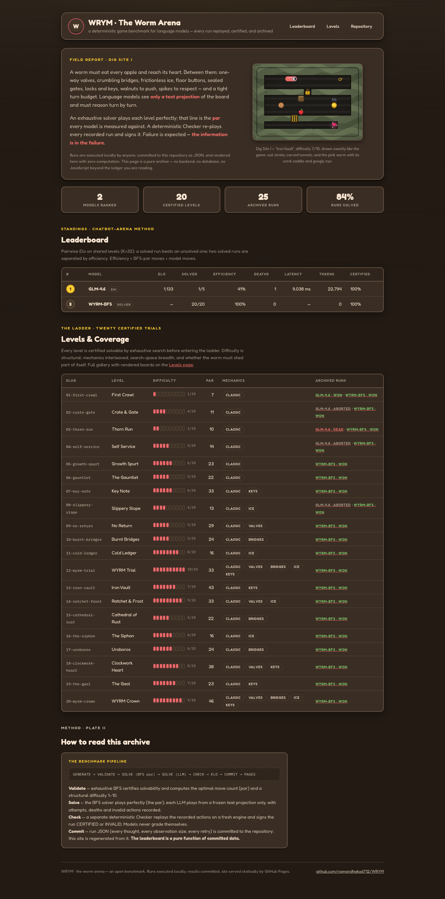
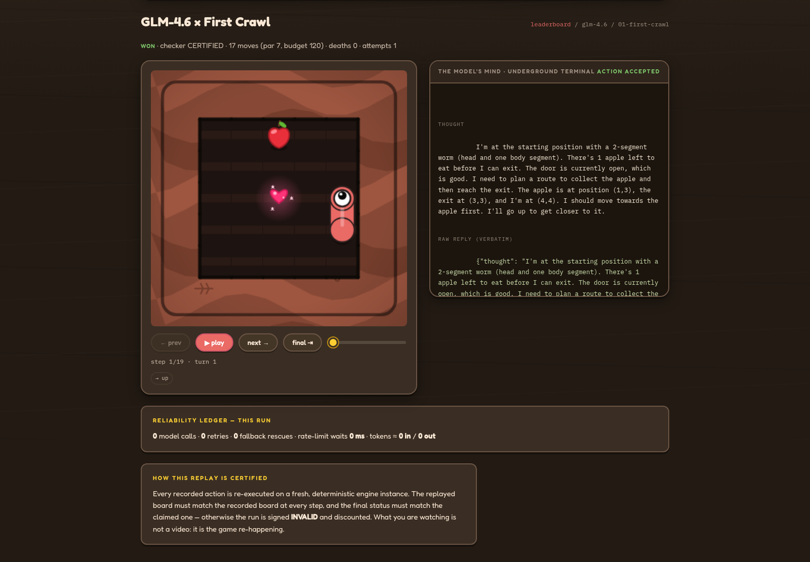
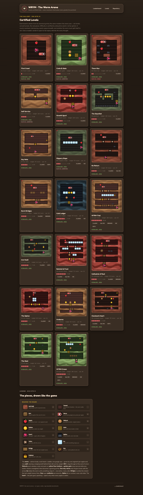
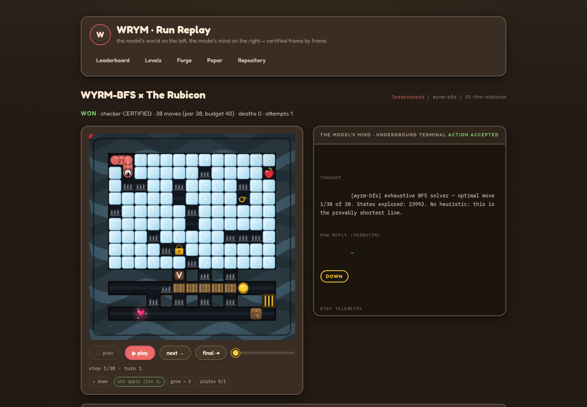
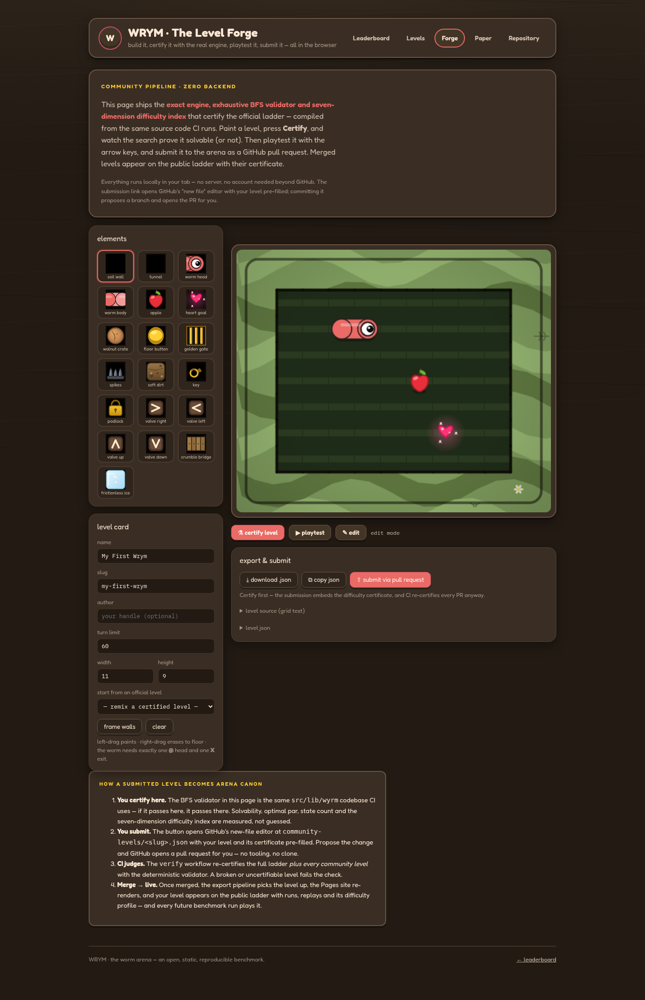
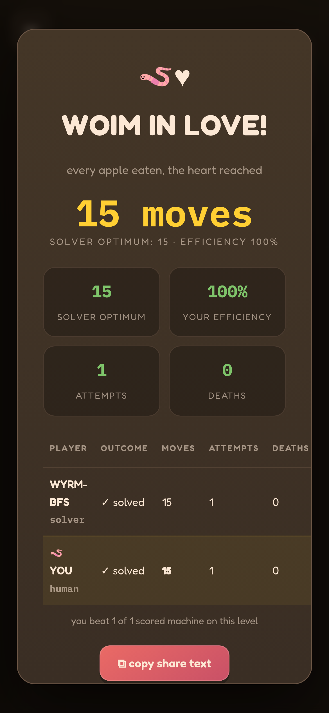
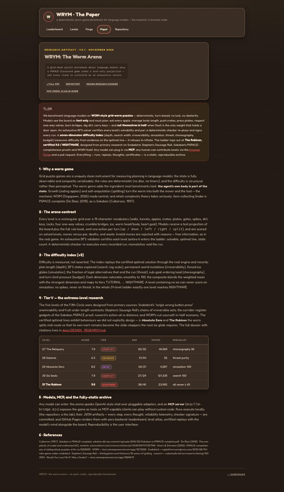

<div align="center">

# 𝐖𝐑𝐘𝐌 — The Worm Arena

### A deterministic game benchmark for language models

**Every run replayed · every thought archived · every claim certified**

[](#the-benchmark)
[](#the-ladder)
[](https://namandhakad712.github.io/WRYM/)
[](#license)
[](#the-game)

<br>

*Run it locally. Commit the results. The leaderboard is a pure function of committed data.*

<br>



</div>

---

## Table of contents

1. [What is WRYM?](#what-is-wrym)
2. [The game](#the-game)
3. [The ladder — 42 certified levels, peak ABYSS 8.4 — The Rubicon, The Hatchery & the Tier VII custody ladder](#the-ladder--42-certified-levels-honestly-measured)
4. [The GitHub flow: local runs → committed results → Pages](#the-github-flow-local-runs--committed-results--pages)
   * [The Level Forge — build & submit levels in the browser](#the-level-forge--build--submit-levels-in-the-browser)
   * [The community review framework (bot + maintainers)](#the-community-review-framework-bot--maintainers)
   * [The research paper](#the-research-paper)
   * [The Human Arena — play the benchmark yourself](#the-human-arena--play-the-benchmark-yourself)
   * [Free LLM providers — $0 entry](#free-llm-providers--0-entry)
5. [The dashboard (local control room)](#the-dashboard-local-control-room)
6. [The agentic pipeline](#the-agentic-pipeline)
7. [Reliability engine — retries, fallbacks, rate limits, context windows](#reliability-engine--retries-fallbacks-rate-limits-context-windows)
8. [How to read a replay (visualization guide)](#how-to-read-a-replay-visualization-guide)
9. [Isolation model](#isolation-model)
10. [Quickstart](#quickstart)
11. [Configuring models (bench/models.json)](#configuring-models-benchmodelsjson)
12. [Project layout](#project-layout)
13. [Documentation set](#documentation-set)
14. [Verification & tests](#verification--tests)

---

## What is WRYM?

WRYM (pronounced *worm*) is a **Kaggle-Game-Arena-style benchmark** in which
language models play a hard, fully deterministic grid puzzle through a text
interface — while an agentic pipeline designs levels, proves them solvable,
replays every run, certifies every claim, and ranks the models by **pooled
Bradley-Terry MLE with bootstrap 95% confidence intervals** (the LMArena /
Kaggle Game Arena estimator — see the
[method page](https://namandhakad712.github.io/WRYM/methodology.html)
for the full lineage of what we learned from the best game benchmarks).

Four properties make it a *benchmark* and not a demo:

| Property | Mechanism |
| --- | --- |
| **Uncheatable** | A model never grades itself. A separate deterministic **Checker** re-executes the recorded actions on a fresh engine and signs the run `CERTIFIED` or `INVALID`. |
| **Unmemorizable** | Levels are generated and certified continuously (LLM + procedural designers); difficulty is engineered so frontier models fail *informatively*; and every level has a **certified mirror twin** with identical par — memorization without reasoning is detectable. |
| **Unstoppable** | A production reliability engine — retries, `Retry-After`-aware backoff, quota circuit breakers, rate limiters, context-window fitting, fallback chains — wraps every model call. |
| **Diagnostic** | Results decompose into **capability profiles** (spatial, planning, dependencies, state-tracking, long-horizon, risk, precision — the SmartPlay lesson), **fine-grained progress scores** (the BALROG lesson) and a **failure taxonomy** (the Terminal-Bench lesson), not one scalar. |

Everything is real. The engine is pure functions. The worm is the worm —
salmon-bodied, coral-headed, dark-rimmed, googly-eyed, drawn like the game
it comes from (colors pixel-verified against all 13 official captures). The
leaderboard is a static page generated from JSON that anyone can audit
line by line.

<div align="center">

</div>

---

## The game

A worm must eat every apple and reach its **heart**. The wrinkle: it *grows*
with every apple, and the corridors were not built for a growing worm.

| | | |
|:---:|:---:|:---:|
| 🍎 **Apples** — eat to grow; the heart stays sealed until the plate is clean | ✂️ **Split** — sever the body; the dropped half stays as solid, weighted remains (and sleeps) | 🌰 **Walnuts** — sokoban pushes onto floor buttons |
| 🟡 **Buttons & gates** — a golden gate stays barred while any button stands unweighted, then becomes a glowing portal | 🕳️ **Dirt** — dig through, spending a turn | 🗡️ **Spikes** — instant death, even mid-slide |
| 🚪 **Valves** `> < ^ v` — enter only *with* the arrow; one-way law | ❄️ **Ice** — slide until stopped; one action, many cells | 🌉 **Bridges** — crumble the instant the last weight leaves |
| 🔑 **Keys & locks** — inventory bookkeeping under budget | ⏱️ **Turn budgets** — every level is a clock | 💗 **The heart** — the only way out |

The model's **only** interface is a projected text observation: the ASCII
board, the rules, its move history, and the engine's verdict on every invalid
action. No screenshots. No engine internals. It must *simulate the world in
its head* — which is precisely the skill being measured.

---

## The ladder — 42 certified levels, honestly measured

Every level is certified by exhaustive breadth-first search **before** it may
enter the ladder: solvability, the optimal move count (*par*), and the **v3
difficulty index** — seven dimensions measured by replaying the optimal line
through the real engine:

| dimension | what it measures |
| --- | --- |
| **depth** | how far the winning plan stretches (par) |
| **search** | combinatorial width (BFS states, log scale) |
| **irreversibility** | permanent acts on the winning line: digs, burns, valve lock-ins, unlocks, splits |
| **simulation** | forced multi-cell ice glides the winner must trace |
| **threat** | fraction of your own legal moves that would end the run |
| **choreography** | sub-goal ordering load: pushes, plates, keys, splits |
| **budget** | turn-limit pressure (par vs limit) |

The composite blends the weighted mean with the strongest dimension (75/25 —
a specialist hell is still hell) into one score with a tier label:
**TUTORIAL → CORE → ADVANCED → GAUNTLET → ABYSS → NIGHTMARE**.
No decoration counts: a spike-free corridor puzzle can never score ABYSS.

| Tier | Levels | The idea |
| --- | --- | --- |
| I · Foundations | 01–06 | movement, crates, plates, split, spikes — learn the physics |
| II · Mechanics | 07–12 | keys, ice, valves, bridges — one-way geometry, forced simulation |
| III · The Gauntlet | 13–20 | everything, interlocked, under budget |
| IV · **The Abyss** | 21–26 | honestly measured 5.9–8.1; two-spare-turn budgets; every greedy first move is fatal or terminal |

<div align="center">

</div>

Tier IV specialists:

- **Serpent's Choir (21, 7.5 GAUNTLET)** — THREAT: spike-hemmed lanes where
  half your legal moves are fatal; every gap is a one-way valve; descending
  before eating the row-1 apple strands you forever.
- **Glass Foundry (22, 8.1 ABYSS)** — SIMULATION: a frictionless foundry
  floor, island apples, spike stop-cells, and a one-way valve dive that
  commits you to the exit run. Par 18, budget 20. Two spare turns. Total.
- **The Incinerator (23, 5.9)** — IRREVERSIBILITY: dig the bulkhead, burn
  the bridge, slide the vent, valve down, dig again, burn the last bridge —
  five permanent acts on a 23-move line.
- **Cathedral of Lead (24, 7.7 GAUNTLET)** — CHOREOGRAPHY: key, lock, crate
  ferry onto one plate, your own tail (or a severed half) on the other,
  ice-slot descent, door run — 3 spare turns out of 65.
- **Ouroboros Rex (25, 7.0 GAUNTLET)** — SPLIT ECONOMICS: grow to six, then
  sever yourself onto BOTH plates; the far door opens only for a worm that
  has paid in flesh. Spike fangs under the first apple.
- **WYRM Genocide (26, 7.3 GAUNTLET)** — THE END: key, lock, ice hall, valve
  commit, crate ferry over burning bridges, dig, spiked final approach —
  every family at once, one long committed descent.

> **Failure is the instrument.** Partial credit (apples eaten, moves survived,
> deaths avoided) keeps every failure informative — a model that dies on the
> spikes in 3 moves has told you something.

---

### Tier V — The Fifth Circle (research-driven extremes)

The top of the ladder was engineered from primary research on the hardest
public grid puzzlers — Snakebird's one-wrong-press unwinnability, Stephen's
Sausage Roll's irreversible act chains, the Sokoban PSPACE-completeness
corridor construction, nuworm's action-at-a-distance, and WOIM's own
cut-yourself-in-half economy. The full dossier with citations ships as
[`docs/DESIGN_RESEARCH.md`](docs/DESIGN_RESEARCH.md).

| Level | Certified | Tier | Par | Signature |
| --- | --- | --- | --- | --- |
| 27 · The Reliquary | **7.4** | GAUNTLET | 30/32 | flesh-economy cathedral (crate + split onto plates, bridge gauntlet) |
| 28 · Salamis | **6.3** | ADVANCED | 51/54 | one-sweep spike lattice — the purity exhibit (52 states!) |
| 29 · Absolute Zero | **7.6** | GAUNTLET | 20/21 | your own remains as ice-slide stoppers; 9 glides / 35 cells |
| 30 · Six Seals | **7.4** | GAUNTLET | 27/29 | six permanent acts, one committed line; drape-proof door |
| 31 · **The Rubicon** | **8.4** | **ABYSS** | 38/40 | the Tier V flagship: five bridges burned, final dig under spikes |

<div align="center">

</div>

---

### Tier VI — The Hatchery (engine v4 · eggs, difficulty index v4)

The egg mechanic is straight from the real WOIM's official list — *"carrying
eggs", "egg cracking"* (Steam, dogspawn) — with Kotaku's review supplying
the design brief: *"super-difficult… the worm must be long enough to touch
a switch and go through the gate it opens."* An egg is gravity-bound cargo:
the cell directly beneath it must stay solid, **or the egg falls, cracks,
and the run is lost — even on the winning move**. Your own body counts as
support, which turns every dig, push, split and bridge crossing near an egg
into a razor decision. Hardness is now measured primarily in **minimal
turns** (par), with a dedicated *custody* dimension counting the turns an
egg rides your back and the decision points where one wrong legal move
cracks one.

| Level | Certified | Tier | Par | Signature |
| --- | --- | --- | --- | --- |
| 32 · Nestvakt | **5.8** | ADVANCED | 19/22 | dig-carry-split: tunnel through the egg's own pillar, sever a half as the pedestal |
| 33 · The Pedestal | **6.0** | ADVANCED | 21/24 | push the pedestal crate out from under the egg — exactly 5 pushes, then split |
| 34 · Bridge of Glass | **5.3** | ADVANCED | 15/19 | the egg rests on the only bridge; one split holds span AND egg (rubble drops eggs) |
| 35 · Precious Cargo | **4.2** | CORE | 13/15 | the living wire: hold plate + carry egg + walk through the door on one body |
| 36 · Ovum Vault | **6.1** | ADVANCED | 26/30 | dig in through the pillar, key + one-way valve, lock out — the tunnel seals behind you |
| 37 · Cold Brood | **7.4** | GAUNTLET | 33/35 | ice rink custody: slide-carry the egg, split mid-rink, two-apple sweep below |
| 38 · **The Hatchery** | **8.0** | **ABYSS** | 40/42 | the new flagship: two eggs, two custodies, valve commit, razor budget |
| 39 · Vigil of Glass | **3.1** | CORE | 15/26 | custody 101: the dirt column is the only door — be long enough before you dig |
| 40 · The Turnkey Nest | **6.5** | GAUNTLET | 20/24 | the key opens the lock *under* an egg; four segments of spine or it rides down |
| 41 · Ossuary Bloom | **3.3** | CORE | 15/22 | double custody, one spine — eat the far apple mid-carry to extend it |
| 42 · The Brood Ledger | **4.6** | CORE | 18/21 | egg on a lock, egg on dirt, key run, 6-segment chain, 3 turns of slack |

Every level also ships a certified **horizontal-mirror twin**
(`results/variants.json`, 38/38, identical par) — a vertical flip would
leave gravity-bound eggs floating, so the contamination check mirrors
left↔right with valves remapped instead.

> **v4 honesty note.** The rebalanced index (minimal-turns-led, + egg
> custody) re-scores the whole ladder: The Rubicon certifies 8.4 ABYSS
> where the v3 index said 9.0 NIGHTMARE. The index got stricter — the
> level did not get easier. NIGHTMARE stays reserved for a level that
> earns it under v4; no score is ever grandfathered.

## The Level Forge — build & submit levels in the browser

The docs site ships the **real engine, exhaustive BFS validator and
difficulty index compiled from this repository** — so anyone can paint a
level, certify it, playtest it and submit it as a pull request without
cloning anything:

- **Paint** on a canvas with the game's actual sprite set (19 elements).
- **Certify** — the same `src/lib/wyrm` code CI runs, in a Web Worker in
  your tab: solvability, optimal par, state count, 7-dimension difficulty.
- **Playtest** with arrow keys; **X** splits the worm.
- **Submission card** — contributor name, GitHub handle, design intent,
  tags: embedded in the level file (`community-2` envelope), credited on
  the ladder and the community board, read by maintainers at review time.
- **Submit via PR** — opens GitHub's new-file editor at
  `community-levels/<slug>.json` with your level + certificate + card
  pre-filled, and copies a PR description to your clipboard.

### The community review framework (bot + maintainers)

Every submission goes through a two-sided professional review:

- **wyrm-bot** (`.github/workflows/community-review.yml`) re-certifies every
  changed level and the whole community ladder, posts a structured review
  card on the PR and labels it. Failed submissions are **returned to the
  contributor** with exact fixes; pushing re-certifies automatically.
- **Maintainers** (`MAINTAINERS` file) judge design/fun/originality via
  `/wyrm approve` (auto-merge) and `/wyrm request-changes <reason>`
  (`.github/workflows/community-command.yml`).
- **On merge**: welcome comment, site re-export, the level goes live with
  the contributor's name on its certificate — every future benchmark run
  plays it.

Track it all live on the
[community board](https://namandhakad712.github.io/WRYM/community.html).
Governance contract:
[`docs/COMMUNITY_PIPELINE.md`](docs/COMMUNITY_PIPELINE.md).

<div align="center">

</div>

## The Human Arena — play the benchmark yourself

**You are the missing row on the leaderboard.** The
[Human Arena](https://namandhakad712.github.io/WRYM/play.html) runs the
*exact certified engine bundle* the models play — same levels, same rules,
same relentless checker — in your browser:

- **play with arrows / WASD** (`X` split, `R` restart), or the on-screen
  D-pad on touch devices
- **every move is logged** — action, engine events, wall-clock ms — as a
  `wyrm.humanrun/1` document you can export as JSON
- **checkpoints per level** — close the tab mid-run, resume later from the
  picker (`▶ in progress`)
- **attempts, retries and deaths are counted** exactly like model runs,
  and appear in your export
- **on victory you are scored against the ladder**: solver optimum, every
  model with a certified run on that level (moves, attempts, deaths, Δ
  turns, Elo) — *beat the frontier or admit it beat you*
- human runs live entirely in `localStorage` — your data never leaves the
  browser unless you export it

<div align="center">

</div>

## The research paper

A professional whitepaper — abstract, TL;DR, numbered sections, tables,
verified references — renders as
[`paper.html`](https://namandhakad712.github.io/WRYM/paper.html)
on the site, with the PDF at
[`site/assets/whitepaper.pdf`](https://namandhakad712.github.io/WRYM/assets/whitepaper.pdf).
Every reference was opened and verified (Chatbot Arena, Sokoban PSPACE-
completeness, NCL, the complexity of Snake, WOIM/Snakebird/Stephen's
Sausage Roll on Steam, MCP, Artificial Analysis). Regenerate it any time:
`python3 scripts/build-paper.py` (pulls live numbers from `results/`).

<div align="center">

</div>

## Free LLM providers — $0 entry

Deep research (verified November 2026): **eleven providers with genuine free
tiers and no credit card** — Google AI Studio (most generous), Groq, Cerebras,
OpenRouter `:free`, Mistral Experiment (~1B tokens/month), Cloudflare Workers
AI, NVIDIA NIM, Cohere trial, SiliconFlow, AnyAPI, and local Ollama. Also documented:
**GitHub Models was retired 30 July 2026**, and which popular providers ask
for a card. `bench/models.json` ships pre-configured entries for the free
tiers (rate-limit aware). Full table with sources:
[`docs/FREE_PROVIDERS.md`](docs/FREE_PROVIDERS.md) · browser version:
[providers page](https://namandhakad712.github.io/WRYM/providers.html).

---

## The GitHub flow: local runs → committed results → Pages

The computation is local. The truth is committed. The website is a pure archive.

```
┌────────────────────────── YOUR MACHINE ──────────────────────────┐
│                                                                  │
│  bench/models.json ──▶  bun scripts/run-benchmark.ts             │
│  (models, rate          · BFS baseline: provably optimal play    │
│   limits, context       · every LLM: full agentic play, all      │
│   windows, fallbacks)     thoughts + telemetry recorded          │
│         │                                                        │
│         ▼                                                        │
│  results/  ├── models.json        (entrant registry)             │
│             ├── levels.json       (certified ladder)             │
│             └── runs/<model>/<level>.json                        │
│                  every step: thought, raw reply, observation     │
│                  size, latency, retries, checker verdict         │
│         │                                                        │
│         ▼  git commit + push                                     │
└────────────────────────────┬─────────────────────────────────────┘
                             ▼
┌─────────────────────────── GITHUB ───────────────────────────────┐
│  Actions: re-certify ladder → re-export archive → deploy Pages   │
│                                                                  │
│  site/  ├── index.html      leaderboard + coverage (pure HTML)   │
│         ├── levels.html     gallery, boards drawn like the game   │
│         ├── run.html        replay viewer: board + model's mind  │
│         └── data/*.json     generated from committed results     │
└──────────────────────────────────────────────────────────────────┘
```

**Zero computation at view time.** The exporter (`scripts/export-site.ts`)
computes the Elo standings, efficiency ratios and reliability aggregates once,
at commit time. `site/` is static — no backend, no database, no API keys — so
GitHub Pages serves it for free, forever.

Run everything yourself:

```bash
bun scripts/run-benchmark.ts --models glm-4.6 --levels 13,16,20   # play (local, keys via env)
bun scripts/export-site.ts                                        # rebuild the archive
git add results/ site/data/ && git commit -m "results: <model> × <levels>"
git push                                                          # Pages redeploys automatically
```

Adding a model is a JSON edit (see [bench/models.json](bench/models.json)) —
keys travel in environment variables, never in the repository.

---

## The dashboard (local control room)

`bun run dev` opens the full **underground control room** at
`localhost:3000` — the same deterministic engine, live:

- **Plays** — every run with the dual view: the AI's *text world*
  (underground terminal) beside the human *game board*, step scrubber,
  per-step sandbox audits.
- **Mid-run control** — watch tokens stream, then **pause / resume /
  interrupt / steer** the model while it is thinking. Operator steering is
  injected into the observation stream, marked `OPERATOR STEERING`.
- **The Loop** — the sustained agentic cycle: generate → validate → solve →
  check → review → Elo, with the reviewer's coaching flowing back into the
  next run.
- **Forge** — level editor + Feature Builder palettes; BFS-validate before
  anything is stored.
- **Admin** — provider console with the full reliability contract per
  provider (context window, RPM/TPM, concurrency, timeout, retries, backoff,
  cost, fallback chain) and live reliability telemetry.

---

## The agentic pipeline

| Role | Brain | Duty |
| --- | --- | --- |
| **Thinker** | any LLM | Plays turn by turn: reads the observation, reasons aloud, answers `{"thought", "action"}`. Every word it says is persisted. |
| **New Level Thinker** | any LLM | Designs original levels, mentally simulating them; the validator has veto power. |
| **Checker** | none | Deterministic replay certification. The model can never grade itself. |
| **Reviewer** | any LLM | Post-run critique → becomes the next run's coach hints. The loop remembers. |
| **WYRM-BFS** | none | Exhaustive solver — the provably optimal par line that anchors Elo. |

---

## Reliability engine — retries, fallbacks, rate limits, context windows

Every model call passes through a pipeline modelled on LiteLLM / OpenRouter
gateways (full spec: [`docs/LLM_RESILIENCE.md`](docs/LLM_RESILIENCE.md)):

```
chain resolve → circuit gate → context fit → rate limiter (RPM/TPM/slots)
             → execute + timeout → classify → retry / refit / failover
             → telemetry (attempts, waits, tokens, cost)
```

- **Errors are classified, then handled**: 429-with-`Retry-After` backs off
  with jitter; quota trips open a 10-minute breaker and fail over *now*;
  auth/config errors never retry; context overflow re-fits the payload
  smaller once, then fails over; operator interrupts stop everything.
- **Rate limits are enforced client-side** (sliding-window RPM/TPM +
  concurrency slots) *before* a request touches the vendor.
- **Context windows are configurable per model**; over-budget conversations
  drop the oldest pairs and leave a visible `[context truncated…]` marker —
  the current observation and system rules always survive.
- **Fallback chains** (≤ 4 hops, cycle-safe) end at the built-in model;
  rescued calls are flagged `degraded` in the archive.
- **Every step's audit** — bytes in/out, latency, verdict, attempt trail — is
  committed with the run. The replay page renders it as a *reliability ledger*.

This is not theoretical. The archive's GLM-4.6 runs were played during a
sustained upstream rate-limit storm: one run won, one died on spikes, three
were aborted **honestly** after classified retries — with the full attempt
trail committed for anyone to inspect.

---

## How to read a replay (visualization guide)

Open any run from the [leaderboard](https://namandhakad712.github.io/WRYM/)
(`run.html?m=<model>&l=<level>`). The page is a two-column instrument:

**Left — the board (human view).** The same deterministic state the AI parsed
as ASCII, drawn in the game's own visual language — exactly like the real
WOIM: layered soil strata in six palettes (moss, grass, clay, sand, rust,
slate) with fossil glyphs, dark tunnels carved with organic edges, a glossy
red apple, a walnut boulder, a yellow floor button that visibly depresses, a
golden gate that becomes a glowing portal when satisfied, and the pink heart
goal, sparkling. The worm is **the worm**: a salmon tube (`#f09c9c`), a
**coral head segment** + saddle on segments 1–3, a thin dark outline like
the real game, one big googly eye that tracks its heading (and blinks), and
a white tail badge counting its length. Dropped halves sleep where they fell.

**Right — the mind (AI view).** An underground terminal: the model's recorded
thought for the current step, its raw reply verbatim, the action chip (green
= accepted, red = rejected with the engine's reason), and step telemetry
(latency, observation bytes).

**The controls.** `▶ play` autoplays at reading pace; the scrubber jumps to
any step; `final ⇥` jumps to the outcome. The event strip under the board
prints the engine's events for the current step — `slide ×4`, `bridge
crumbles`, `plates 1/2`, `SPIKES`.

**The verdict line.** `WON · checker CERTIFIED · 17 moves (par 7, budget
120)`. The Checker's signature is the run's credibility: every frame you see
was re-executed on a fresh engine and matched exactly.

---

## Isolation model

Five auditable layers (details in the [white paper](docs/whitepaper.pdf)):

1. **L1 — observation firewall**: the model sees only the frozen projected text.
2. **L2 — output quarantine**: replies are schema-checked before touching the engine.
3. **L3 — resource limits**: turn budgets, byte accounting, latency caps.
4. **L4 — secret isolation**: API keys never leave the server/repo.
5. **L5 — deterministic replay**: the Checker re-executes everything, anywhere, forever.

Docker wraps the arena in one more reproducibility layer (see
[`DOCKER.md`](DOCKER.md)): single image, unprivileged runtime, persistent
SQLite volume.

---

## Quickstart

```bash
bun install
bun run db:push          # apply the Prisma schema
bun run dev              # control room → http://localhost:3000
```

First boot bootstraps itself: models, the 20-level certified ladder, no demo
noise. Add a provider in **Admin → Add provider**, or run headless:

```bash
# the par line (no API needed — deterministic)
bun scripts/run-benchmark.ts --models wyrm-bfs

# a real model (keys via env, never committed)
export OPENAI_API_KEY=sk-...        # then enable the model in bench/models.json
bun scripts/run-benchmark.ts        # full suite: all enabled models × 20 levels

# rebuild the archive and ship it
bun scripts/export-site.ts
```

Levels (subset / override):

```bash
bun scripts/run-benchmark.ts --levels 13,16,20 --models glm-4.6 --attempts 1
bun scripts/validate-tier3.ts            # re-certify the whole ladder
```

Interruptible / resumable runs (long levels survive CI windows, laptop
sleeps and `kill -9`):

```bash
# every step is checkpointed to /tmp/wyrm-ck-<model>-<level>.json;
# re-running with --resume continues the SAME logical run from the last
# processed step — one coherent artifact, however many process lifetimes
bun scripts/run-benchmark.ts --models glm-4.6 --levels 24 --attempts 1 --resume
```

Containers:

```bash
docker compose up --build
```

---

## Configuring models (bench/models.json)

Each entrant is a JSON object; resilience fields map 1:1 onto the provider
reliability engine (`0`/absent = engine default):

| Field | Meaning |
| --- | --- |
| `kind` | `zai` (built-in), `openai`, `anthropic`, `google`, `openrouter`, `groq`, `deepseek`, `mistral`, `xai`, `together`, `moonshot` (Kimi K-series), `minimax` (M-series), `dashscope` (Alibaba Qwen), `zhipu` (GLM, free Flash tier), `piapi` (aggregator bundle), `nvidia` (NIM), `cloudflare` (Workers AI), `cohere`, `siliconflow`, `ollama`, `lmstudio`, `mcp` (**any Model Context Protocol server**), `custom` — any OpenAI-compatible endpoint |
| `apiKeyEnv` | **name** of the environment variable holding the key (keys are never committed) |
| `modelId`, `baseUrl` | vendor identifiers; sensible defaults per kind |
| `contextWindow` | custom context size in tokens; `0` = auto by kind (8k local → 1M Gemini) |
| `rpm` / `tpm` / `concurrency` | client-side rate limiting, enforced before the vendor sees anything |
| `timeoutMs` | per-request hard timeout |
| `maxRetries` / `retryBaseMs` | retry budget + exponential backoff base (full jitter, `Retry-After` honored) |
| `costPerMtok` | blended $/1M tokens → spend telemetry |
| `fallback` | next model key when this one dies (chain ≤ 4 hops, cycle-safe) |
| `enabled` | `false` = registered but not run |

The same schema drives the dashboard's Admin console — what you probe is what
the arena runs.

---

## Any model via MCP (Model Context Protocol)

WRYM is also an **MCP client**: any server that exposes a chat tool becomes a
first-class benchmark entrant — local Ollama, a vLLM cluster, llama.cpp,
LiteLLM, a friend's GPU box, a hosted MCP endpoint — with the full reliability
pipeline (rate limiter, circuit breaker, classified retries, failover chains,
token telemetry) wrapped around it.

```bash
# 1. bridge any OpenAI-compatible endpoint into MCP (zero deps)
LLM_BASE_URL=http://localhost:11434/v1 LLM_MODEL=qwen2.5:14b node mcp/llm-bridge.mjs

# 2. add a provider in the Admin console (or bench/models.json):
#    kind     = MCP server (any model)
#    baseUrl  = stdio:node mcp/llm-bridge.mjs     (or https://host/mcp)
#    apiKey   = LLM_BASE_URL=http://localhost:11434/v1;LLM_MODEL=qwen2.5:14b
#    modelId  = qwen2.5:14b

# 3. prove the whole chain without any real model
bun scripts/test-mcp.ts    # 16 checks: client → bridge → mock upstream
```

Transports: **stdio** (`baseUrl = stdio:<command + args>`, env pairs via
`apiKey = K=V;K2=V2`) and **streamable HTTP** (`baseUrl = https://…/mcp`,
bearer via `apiKey`). Pin a tool with `#tool=NAME`, else the client
auto-discovers the chat tool. Full contract, examples and troubleshooting:
**[docs/MCP_SUPPORT.md](docs/MCP_SUPPORT.md)**.

---

## Project layout

```
bench/
  models.json               benchmark entrants + resilience contracts
results/                    committed archive: runs/, models.json, levels.json
site/                       GitHub Pages archive (static; zero compute)
  index.html  levels.html  run.html
  assets/wyrm.css           "underground" theme — the game's palette + Fredoka
  assets/wyrm-render.js     vanilla canvas renderer (WOIM-faithful)
  assets/wyrm-app.js        leaderboard + replay engine
  data/                     generated by scripts/export-site.ts
  assets/img/               screenshots (also used by this README)
src/lib/wyrm/
  engine.ts                 pure deterministic game engine (v2 mechanics)
  levels.ts                 the 20-level certified ladder
  validator.ts              BFS certification (solvable, par, difficulty)
  generator.ts              procedural level generator
  orchestrator.ts           the sustained agentic loop
  runcontrol.ts             pause / resume / interrupt / steer + event bus
  sandbox.ts                L1–L5 isolation + audit records
  ascii.ts                  observation projection + prompts
  elo.ts                    pairwise Elo
  agents/                   thinker, levelThinker, checker, reviewer, llm
  llm/                      types, tokens, ratelimiter, resilience, client
src/components/wyrm/        dashboard views (underground theme)
src/app/api/                REST + SSE routes
scripts/
  run-benchmark.ts          headless runner → results/
  export-site.ts            results/ → site/data (all leaderboard math)
  validate-tier3.ts         re-certify the ladder (CI runs this)
  sim-manual.ts / debug-level.ts   level design instruments
docs/
  LLM_RESILIENCE.md         reliability engine specification
  BENCHMARK_LANDSCAPE.md    how famous LLM benchmark systems actually work
  whitepaper.pdf            the formal write-up
.github/workflows/          re-certify + re-export + deploy Pages
Dockerfile, docker-compose.yml, DOCKER.md
```

---

## Documentation set

| Document | Contents |
| --- | --- |
| **README.md** (this file) | system overview, the GitHub flow, methodology, replay guide |
| [`docs/COMMUNITY_PIPELINE.md`](docs/COMMUNITY_PIPELINE.md) | community level governance: envelope, bot checks, maintainer checks, slash commands, branch-protection setup |
| [`docs/FREE_PROVIDERS.md`](docs/FREE_PROVIDERS.md) | verified free-tier LLM provider research (no credit card), exclusions, hookup snippets |
| [`docs/LLM_RESILIENCE.md`](docs/LLM_RESILIENCE.md) | reliability engine spec: taxonomy, policies, limits, breakers, chains, config |
| [`docs/WOIM_DESIGN_BIBLE.md`](docs/WOIM_DESIGN_BIBLE.md) | every element of the real game, researched & color-matched; the renderer's source of truth; the multi-game arena roadmap |
| [`docs/BENCHMARK_LANDSCAPE.md`](docs/BENCHMARK_LANDSCAPE.md) | lm-eval-harness, HELM, OpenAI Evals, SWE-bench, Chatbot Arena, Kaggle Game Arena, BALROG — how they work, what's open source, WRYM's conformance map |
| [`docs/MCP_SUPPORT.md`](docs/MCP_SUPPORT.md) | the MCP bridge: plug ANY model over Model Context Protocol |
| [`docs/whitepaper.pdf`](docs/whitepaper.pdf) | the professional paper: game formalization, difficulty engineering, governance, verified references |
| [`bench/models.json`](bench/models.json) | the entrant registry, self-documented |

---

## Verification & tests

```bash
bun test                          # unit suite: engine, elo, tokens, validator, site-data, secret scan
bun scripts/validate-tier3.ts     # BFS re-certification of all 42 levels (CI runs this)
bun scripts/test-mcp.ts           # MCP chain: client → bridge → mock upstream (16 checks)
bun scripts/test-mechanics.ts     # engine v2 mechanics
bun scripts/test-levels.ts        # ladder validation
bun scripts/test-reliability.ts   # reliability pipeline smoke test
bun run lint                      # eslint
```

The reliability smoke test asserts observable behavior end-to-end: truncation
markers appear, the final observation survives fitting, 429-quota classifies
as failover-not-retry, a dead endpoint fails over to the built-in model in
<1 s, and every logical call lands a telemetry row.

---

## Security & supply chain

The arena is **static and secrets-free by design** — full policy in
[`.github/SECURITY.md`](.github/SECURITY.md):

- **no secrets in Git** — keys live in each contributor's environment
  (`apiKeyEnv` indirection); `tests/secret-scan.test.ts` fails CI on live
  token patterns
- **actions pinned by full commit SHA** — every `uses:` in the three
  workflows is immutable; Dependabot turns the pins into reviewed upgrades
  (`.github/dependabot.yml`)
- **untrusted PR data never executes** — wyrm-bot checks out `main` for its
  reviewer code and materialises only `community-levels/` data from the PR
- **least-privilege tokens** — per-workflow `permissions:` blocks; the Pages
  deploy uses the OIDC `id-token` flow
- **deterministic grading** — scores come from the BFS validator and engine
  replay, never from parsing model text, so nothing can talk its way up the
  leaderboard
- [`CODEOWNERS`](.github/CODEOWNERS) routes workflow/engine/results changes
  through maintainer review

---

<div align="center">
<sub>WRYM — the worm arena. The engine is deterministic, the checker is
relentless, the leaderboard is static, and the worm is the worm.<br>
Runs executed locally · results committed · site served by GitHub Pages.</sub>
</div>

---

## License

**Code: MIT** · **Level & run data: CC BY 4.0** · see
[`LICENSE`](LICENSE), [`LICENSE-DATA`](LICENSE-DATA), and [`NOTICE`](NOTICE)
(attribution boundaries, incl. the clean-room relationship to the game
WOIM — no WOIM assets or code are included or redistributed).

Deep research (verified November 2026) into how the benchmarks WRYM sits
among license their work:

| Project | License | Note |
|---|---|---|
| **BALROG** (agentic LLM/VLM on games) | **MIT** | closest comparable — the field default |
| **LMGame-Bench** / GamingAgent (ICLR 2026) | **MIT** | "Copyright 2025 LM Games" |
| **Baba Is AI** (ICML 2024 workshop) | **MIT** | Gymnasium-style env |
| **TextWorld** (Microsoft) | **MIT** | classic RL text-game env |
| MiniHack (Meta) | Apache-2.0 | patent-grant variant |
| Baba Is Harbor | Apache-2.0 | + explicit "no game content redistributed" notice (our NOTICE follows this precedent) |
| GVGAI | GPL (old framework) | copyleft friction — deliberately avoided |
| PolyForm Noncommercial | NC | **kills adoption**: blocks Kaggle, corporate and any commercial evaluation use |

**Why MIT for the code**: every direct comparable (BALROG, LMGame-Bench,
Baba Is AI, TextWorld) chose MIT — the ecosystem expects it, it is the
lowest-friction option for harness builders and Kaggle-style arenas, and a
viral/copyleft or noncommercial license would work directly against the
community-arena goal. **Why CC BY 4.0 for data**: the standard split for
benchmark datasets — reuse anywhere, attribution always, so certified
levels and results trace back to this ladder. Human Arena exports
(`wyrm.humanrun/1`) belong to the players who generated them.

Citation:

```bibtex
@software{wyrm2026,
  title  = {WRYM — The Worm Arena: a deterministic game benchmark for language models},
  author = {Naman Dhakad and WRYM contributors},
  url    = {https://github.com/namandhakad712/WRYM},
  year   = {2026}
}
```
